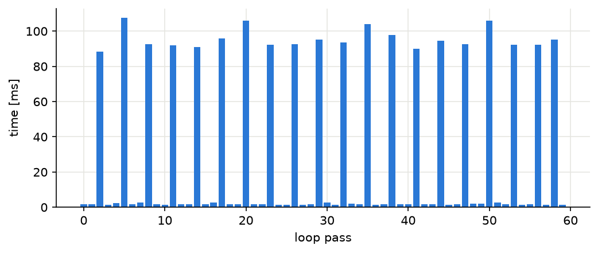
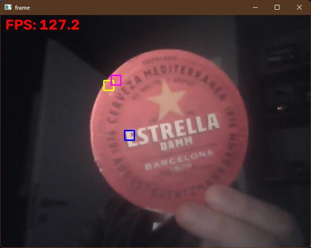
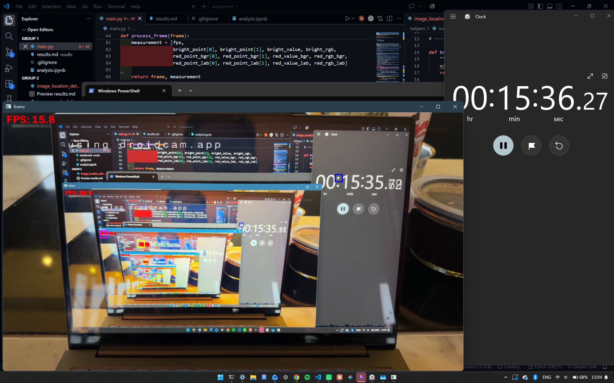
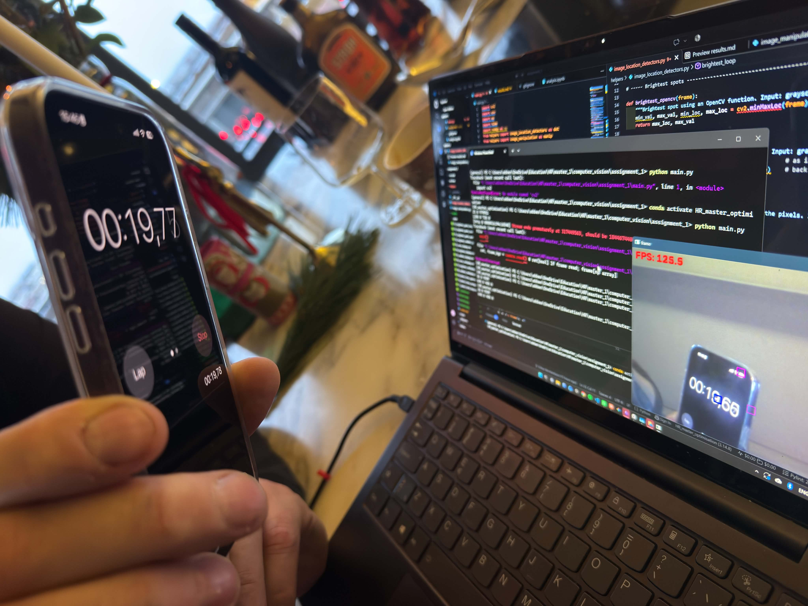

# Assignment 1: Real-time bright spot detection
Github: https://github.com/eirikur7/TOLVUSJON_assignment1.git

All numbers come from my own runs. Raw logs are the CSV files in `results/`, plots are made in `analysis.ipynb`.

**Code**
- `main.py`: the live loop (read frame → process → display).
- `helpers/image_location_detectors.py`: brightest and reddest spot detectors.
- `helpers/image_manipulation.py`: colour conversion and drawing boxes.

Each version in the results table was run by commenting lines in or out of `main.py`.

## Tasks 1-2: Live video and FPS

Frames are read with `cv2.VideoCapture` and shown with `cv2.imshow`. FPS is $1/\Delta t$, where $\Delta t$ is the time since the previous frame (`time.perf_counter()`), and it is drawn on the frame with `cv2.putText`.

The first readings showed around 300 fps, which is not possible for a 30 fps camera. Timing each loop pass shows a repeating pattern of two fast passes (~2 ms) and one long one (~95 ms):

The fast passes return the same frame again, so the loop runs faster than the camera delivers new images. The mean time per frame is still 33.3 ms (30 fps), so the camera sets the pace. The table below therefore uses the mean.

## Task 3: Brightest spot

The frame is converted to grayscale (`cv2.cvtColor`) and the location of the maximum is found with `cv2.minMaxLoc`. A blue box is drawn there.

## Task 4: Reddest spot

Two definitions of redness were used, and the reddest spot is the maximum of each (`cv2.minMaxLoc`).

| | Colour space | Redness | Box |
|---|---|---|---|
| A | BGR | $R - \frac{G+B}{2}$ | yellow |
| B | L\*a\*b\* | a\* channel (green ↔ red axis) | magenta |

Colour of the pixel each detector picked, frame by frame (run with all detectors on):

Both pick dark reds. Definition A leans towards brown/orange shades, while B leans towards wine-red shades with a bit of purple, since a\* is also high for colours with blue in them.

Frame where the two definitions disagree (yellow = A, magenta = B, blue = brightest):

**Choice:** I chose definition A (BGR). It subtracts both green and blue, so it rewards pixels that are clearly red rather than purple. Its weakness is that it depends on brightness, so a brightly lit red scores higher than the same red in shadow.

## Task 5: Three implementations of the brightest spot

Time of the detector call only:

| Method | Mean time [ms] | vs. OpenCV | FPS |
|---|---|---|---|
| OpenCV `cv2.minMaxLoc` | 0.036 | 1× | 30.0 |
| NumPy `np.argmax` | 0.079 | ~2× | 30.0 |
| Python double for-loop | 32.5 | ~900× | 25.8 |

OpenCV and NumPy run compiled code over the whole array and are far below the 33 ms frame time, so they do not affect the FPS. The Python loop goes through ~300 000 pixels one at a time, which takes about one full frame and drops the FPS to 25.8.

## Results table (laptop camera)

| Version | Time per frame [ms] | FPS |
|---|---|---|
| No detection, display | 33.3 | 30.0 |
| Brightest, display | 33.3 | 30.0 |
| Reddest, display | 33.3 | 30.0 |
| No detection, no display | 33.3 | 30.0 |
| Brightest, no display | 33.3 | 30.0 |
| Reddest, no display | 33.3 | 30.0 |

All versions run at the camera's 30 fps, since the detections and display are much faster than the time between new frames. Only the Python loop (task 5) is slow enough to lower the FPS.

## Task 6: Phone camera

The phone streams over Wi-Fi with the DroidCam app, and OpenCV reads the stream from its URL (`http://<phone-ip>:4747/video`). The phone sends 1280 × 720 frames, compared with 640 × 480 from the laptop camera.

The FPS was not consistent. In some runs it was only 5-10 fps, and after restarting it could jump up to 25-30 fps. Likely causes are the Wi-Fi connection and my laptop, which is old and has been slow lately.

## Task 7: Latency

A millisecond stopwatch was shown next to the video window, with the camera pointed at it. Latency = real time − time shown in the video.

| # | Laptop camera [ms] | Phone camera [ms] |
|---|---|---|
| 1 | 110 | 550 |
| 2 | 190 | 1200 |
| 3 | 170 | 420 |
| **Mean** | **≈ 160** | **≈ 720** |

The phone is about 4-5× slower and much less consistent. The extra delay comes from compressing the video on the phone, sending it over Wi-Fi and decoding it on the laptop. The laptop readings are uncertain by about ±20 ms, since some digits were caught mid-change.

All screenshots: `phone1-3.png`, `latency_laptop_camera_1-3.jpg`.
