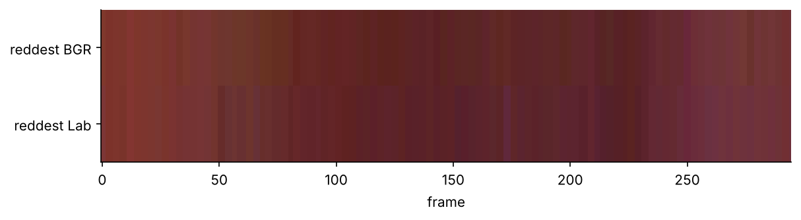
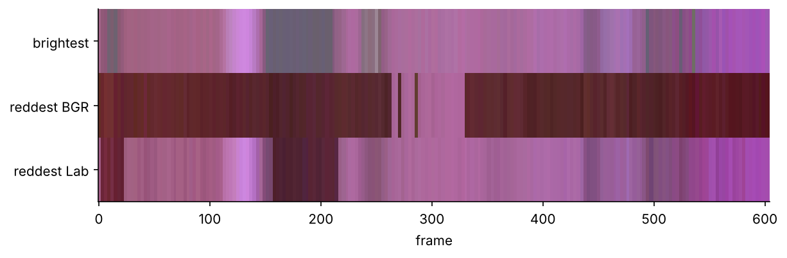
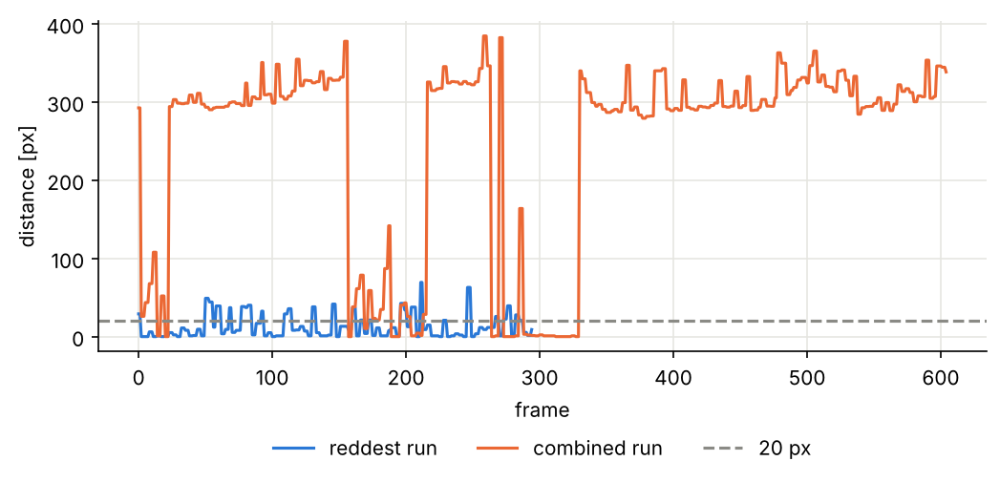
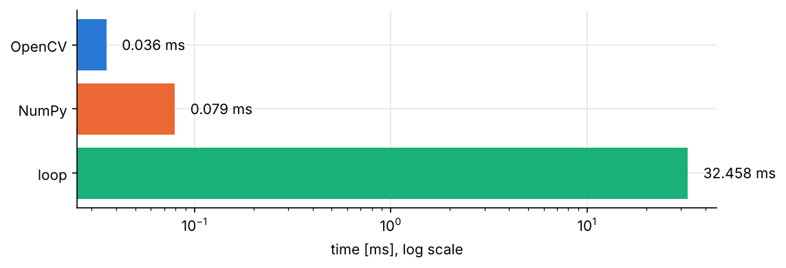
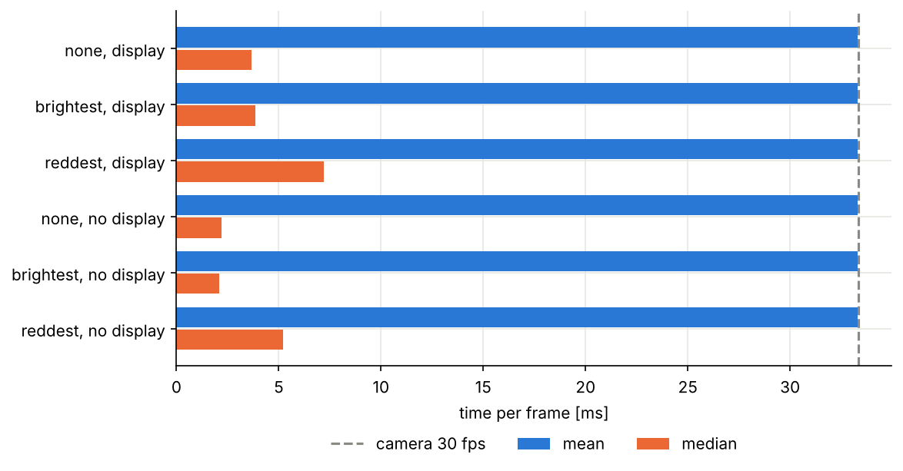

# Assignment 1: Real-time bright and red spot detection

Live video from the laptop camera with OpenCV and Python: show FPS, mark the brightest spot and the reddest spot, compare three ways of finding the brightest spot, and measure latency.

All numbers below come from my own runs. Raw data: the CSV files in `results/`. Plots: `results/plots/`, made by `analysis.ipynb`.

---

## Setup

| | |
|---|---|
| Computer | Windows laptop, built-in camera |
| Software | Python 3.14, OpenCV (`opencv-python`), NumPy |
| Camera backend | MSMF (OpenCV's default on Windows), reports 30 fps |
| Image size | 640 × 480 |
| Runs | 300 frames each, first 5 frames skipped when averaging |

**Code**

- `main.py`: the live loop: get frame → process frame → show frame.
- `helpers/image_location_detectors.py`: functions that find a location (brightest, reddest). Each returns `(x, y)` and the value there.
- `helpers/image_manipulation.py`: colour conversion and drawing a box.
- Each version in the results table was run by commenting lines in or out of `main.py`.

---

## Tasks 1–2: Live video and FPS

The frame is read with `cv2.VideoCapture`, shown with `cv2.imshow`, and the loop stops on `q`.

FPS is measured as `1 / (time since the previous frame)`, using `time.perf_counter()`, and drawn on the frame with `cv2.putText`.

### Observation: the loop runs faster than the camera

The first FPS readings were around **300 fps**, which is impossible for a 30 fps camera. Looking at the loop pass by pass shows why:

- The pattern repeats: **two fast passes (~2 ms), then one long wait (~95 ms)**.
- Printing the frames showed groups of **identical frames**.
- So `camera.read()` often returns the *same* image again instead of waiting for a new one. The fast passes are duplicates.

**Conclusion:** FPS of the loop is not the same as the rate of new images. The average still comes out at 33.3 ms per frame (30 fps), so the camera sets the pace.

---

## Task 3: Brightest spot

1. Convert the frame to grayscale (`cv2.cvtColor`, `COLOR_BGR2GRAY`).
2. Find the location of the maximum with `cv2.minMaxLoc`.
3. Draw a box there.

---

## Task 4: Reddest spot, two definitions

| | Colour space | "Redness" of a pixel |
|---|---|---|
| **A** | BGR | $R - \frac{G+B}{2}$: how much more red than the other two channels |
| **B** | L\*a\*b\* | the **a\*** channel: position on the green ↔ red/magenta axis |

For both, the reddest spot is the location of the maximum redness (`cv2.minMaxLoc`).

### What each definition picks

The colour of the pixel each definition picked, frame by frame:

- In the reddest-only run they point at different places (more than 20 px apart) in **26 %** of frames. In the combined run it is **85 %**.
- **BGR** picks **dark, deep red/brown** pixels.
- **Lab a\*** often picks **pink/magenta** pixels. That is because a\* is high for anything on the red–magenta side, including colours with a lot of blue.

*(TODO: add one screenshot of a frame where the two boxes disagree.)*

### Which definition I chose and why

*(Draft, edit to your own words.)*
I chose **definition A (BGR, $R - \frac{G+B}{2}$)**. It subtracts blue as well as green, so it rewards pixels that are *red* and not pink or purple. Lab a\* is perceptually better founded, but it treats magenta as "red", which is what made it disagree in most frames.
The downside of A is that it depends on brightness: a brightly lit red scores higher than the same red in shadow. A fix would be to divide by brightness, or use hue and saturation in HSV.

---

## Task 5: Brightest spot, three implementations

Time of **only the detector call**, measured with `time.perf_counter()` around it:

| Method | Mean time [ms] | Compared with OpenCV | Overall FPS |
|---|---|---|---|
| OpenCV `cv2.minMaxLoc` | 0.036 | 1× | 30.0 |
| NumPy `np.argmax` + `np.unravel_index` | 0.079 | ~2× slower | 30.0 |
| Python double for-loop | 32.5 | **~900× slower** | **25.8** |

- OpenCV and NumPy are both far below the camera's 33 ms per frame, so they do not change the FPS at all.
- The loop takes ~32 ms per frame. That alone is about one camera frame, so FPS drops to 25.8.
- Why: OpenCV and NumPy run compiled, vectorised code over the whole array. The Python loop runs the interpreter once per pixel (~300 000 times per frame).

---

## Results table (laptop camera)

| Version | Mean time per frame [ms] | FPS | Median loop pass [ms] |
|---|---|---|---|
| No detection, display | 33.3 | 30.0 | 3.65 |
| Brightest, display | 33.3 | 30.0 | 3.88 |
| Reddest, display | 33.3 | 30.0 | 7.19 |
| No detection, no display | 33.3 | 30.0 | 2.19 |
| Brightest, no display | 33.3 | 30.0 | 2.09 |
| Reddest, no display | 33.3 | 30.0 | 5.20 |

**How to read it:**

- **Mean** = what you actually get. It is the same (30 fps) in every version, because the loop waits for the camera.
- **Median** = cost of one loop pass (most passes are the fast duplicate reads). Differences in the median show what each part costs:
  - display (`imshow` + `waitKey`): ≈ 1.5 ms
  - brightest spot: too small to measure here
  - reddest spot (both definitions): ≈ 3–3.5 ms, mostly the Lab conversion and the int16 copy

---

## Task 6: Phone camera

*(TODO: app used (DroidCam / iVCam), connection (Wi-Fi / hotspot), camera index, and the FPS from one run.)*

---

## Task 7: Latency

Method: a running millisecond timer on screen, camera pointed at it, screenshot showing both the timer and the displayed video frame. Latency = timer value − value visible in the video.

| Camera | Run 1 [ms] | Run 2 [ms] | Run 3 [ms] | Mean [ms] |
|---|---|---|---|---|
| Laptop | TODO | TODO | TODO | TODO |
| Phone | TODO | TODO | TODO | TODO |

*(TODO: add the screenshots.)*

---

## Summary

- The camera's 30 fps limits everything except the Python loop.
- Loop FPS ≠ camera FPS: OpenCV's MSMF backend returns duplicate frames, so "300 fps" was the loop spinning, not new images.
- OpenCV and NumPy find the brightest pixel in well under 0.1 ms. A Python double loop takes ~32 ms (~900× slower).
- "Reddest" depends on the definition. BGR $R - \frac{G+B}{2}$ finds deep red, Lab a\* also rewards pink/magenta.
